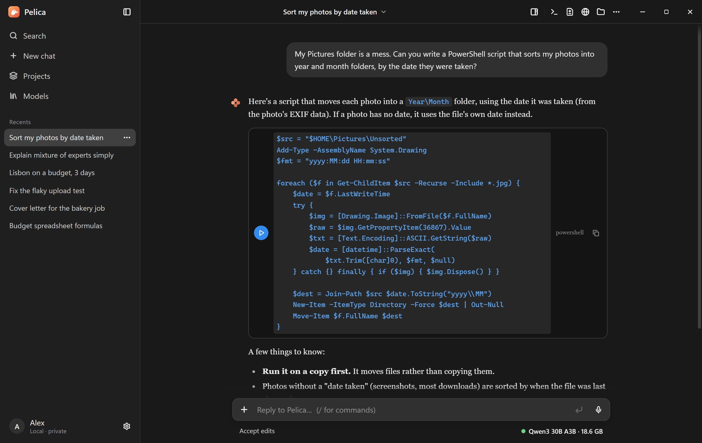

<p align="center">
  
</p>

<h1 align="center">Pelica</h1>

<p align="center">
  <b>Run huge AI models on the PC you already have.</b><br />
  A 164 GB model on a 16 GB graphics card. Free, open source, and entirely on your computer.
</p>

<p align="center">
  <a href="https://github.com/HumandubleOfficial/Pelica/releases/latest"></a>
  <a href="https://github.com/HumandubleOfficial/Pelica/releases"></a>
  
  
  <a href="LICENSE"></a>
</p>

<p align="center">
  <a href="https://github.com/HumandubleOfficial/Pelica/releases/latest"><b>Download for Windows</b></a> ·
  <a href="https://pelica.scrper.co.uk/">Website</a> ·
  <a href="docs/ENGINE.md">How the engine works</a> ·
  <a href="https://github.com/HumandubleOfficial/Pelica/issues">Report a problem</a>
</p>

<p align="center">
  
</p>

## Why Pelica

The biggest open models today, like DeepSeek V4 and Qwen3, are **mixtures of experts**: thousands of small expert networks, of which each token only uses a handful. Pelica takes advantage of that. It keeps the shared layers and the busiest experts on your GPU, the next tier in RAM, and streams the rest from your SSD just before it's needed. Models far bigger than your graphics card, or even your graphics card and RAM together, run at usable speeds.

- **Bigger than your hardware.** DeepSeek V4 Flash (164 GB) runs at about 4.5 tokens/s on a 16 GB RTX 5060 Ti with 32 GB of RAM.
- **Fast when it fits.** gpt-oss-20b runs entirely on the GPU at 112–141 tokens/s.
- **Same answers, just faster.** Pelica is checked token by token against llama.cpp and Colibrì, and none of its speedups change the output.
- **No CUDA, no Python.** One installer. The engine is written in Rust and talks to any Vulkan graphics card.
- **Private.** Models run on your PC, your chats stay on your PC, and there's no account, server or telemetry.
- **A real assistant, not just a chat box.** It can work in your folders (asking before every command), search the web, use MCP connectors, and remember things between chats.

## Benchmarks

One mid-range gaming PC: Ryzen 5 8400F, 32 GB DDR5, RTX 5060 Ti 16 GB, one PCIe 4 NVMe SSD.

| Model | Size | Runs on | Decode speed |
|---|---:|---|---:|
| OLMoE 1B-7B | 4.2 GB | GPU | 180 tok/s |
| gpt-oss-20b | 12.3 GB | GPU | 112–141 tok/s |
| Qwen3 30B A3B | 18.6 GB | GPU + RAM | 78 tok/s |
| Qwen3.8 Flash Next | 94 GB | GPU + RAM + SSD | 16.5 tok/s |
| DeepSeek V4 Flash | 164 GB | GPU + RAM + SSD | 4.5 tok/s |
| GLM-5.3-Flash (320B) | — | GPU + RAM + SSD | 3.2 tok/s (Colibrì: 0.76) |

Prompt processing runs on the tensor cores: 1,773 tok/s for gpt-oss-20b, 2,155 tok/s for OLMoE, and a 4,000-token prompt in 27 s on Qwen3.8 Flash Next. Methods, raw numbers and the history of each speedup are in [docs/ENGINE.md](docs/ENGINE.md#benchmarks).

## Getting started

1. **[Download the installer](https://github.com/HumandubleOfficial/Pelica/releases/latest)** and run it. Pelica updates itself from then on (Settings → About).
2. **Pick a model.** Open **Models** in the sidebar. It suggests models that fit your PC and searches Hugging Face for GGUF files, showing which ones will run before you download.
3. **Chat.** To let it work on files, choose a folder in the message box. It shows every change and asks before running a command.

**You need:** Windows 10 or 11 (64-bit), a processor with AVX2 (Intel 2013+, AMD 2015+) and a graphics card with Vulkan drivers. For the largest models: 12–16 GB of graphics memory, 32 GB of RAM and a fast NVMe SSD. The SSD's speed sets the pace once a model spills onto it.

## What's in the app

| | |
|---|---|
| **Works in your folders** | Reads, writes and edits files with diffs, runs commands after asking, and keeps a to-do list on long tasks. Permission modes from "ask for everything" to "auto". |
| **Model library** | Models on your PC and on Hugging Face, with a fit check for your hardware and a storage manager. |
| **Web search** | Any model can search the web and read pages when a question needs it. |
| **Connectors** | MCP servers on your PC or online, with per-tool permissions. Imports the ones you set up in Claude Desktop, Claude Code, Cursor, Windsurf or VS Code. |
| **Projects and memory** | Chats that share instructions, files and a folder. Memory that carries facts between chats, which you can read and edit. |
| **Import** | Brings your history over from a ChatGPT or Claude data export. |
| **Pelica on your phone** | Scan a QR code to follow and answer the open chat from your phone, over your own Wi-Fi. |
| **Vision** | Models that can see (Qwen3.8 Flash Next) read the pictures you attach. |
| **Other PCs' RAM** | A second computer on your network can hold experts too (`pelica bridge`). |

## From the terminal and your own code

The installer puts `pelica` on your PATH. With no arguments it's a coding agent in the current folder, with the same tools and permission prompts as the app:

```bash
pelica                                   # chat in this folder
pelica -c                                # carry on the latest chat here
pelica chat --mode auto -p "add a --verbose flag and run the tests"
pelica --model Qwen3-30B-A3B-Q4_K_M.gguf -p "Why is the sky blue?"
```

Turn on **Settings → Models → Local API** and Pelica serves an OpenAI-compatible API for whichever model is loaded, so existing tools and scripts can use it:

```bash
curl http://127.0.0.1:11435/v1/chat/completions \
  -H "Content-Type: application/json" \
  -d '{"model": "local", "messages": [{"role": "user", "content": "Hello!"}]}'
```

## Supported models

| Family | How it runs | Notes |
|---|---|---|
| gpt-oss (20B) | Whole model on the GPU | Exact greedy decoding with drafting, 131K context spilling to RAM |
| DeepSeek V4 Flash | GPU + RAM + SSD tiers | 164 GB Q4_K GGUF |
| Qwen3.8 Flash Next | GPU + RAM + SSD tiers | 94 GB in three files, vision |
| GLM-5.3-Flash | GPU + RAM + SSD tiers | Colibrì's int4 container |
| Any other MoE GGUF | General engine | Qwen3-MoE, OLMoE, Mixtral-style and others; context spills from VRAM to RAM to SSD |

Not supported yet: DeepSeek V2/V3-style latent attention (MLA).

## How it works

```
 GPU   16 GB   shared layers and the hottest experts — the GPU computes here
 RAM   32 GB   the next-hottest experts, evicted by heat
 SSD    2 TB   the rest of the model; experts heat up here and get promoted
```

- **Heat, not recency.** Pelica tracks how highly the router ranks every expert, not only the ones it picks, so a near-miss is already warm before it's chosen. Plain LRU is the wrong fit: experts come round once per token in layer order, and LRU evicts exactly the ones whose layer is next.
- **Reading ahead.** It runs the next layer's router early and starts reading the experts it will probably need. The top guess is right about 99% of the time. Guesses that turn out wrong are cancelled.
- **A drive scheduler.** Unbuffered, overlapped reads on an I/O completion port keep the SSD busy at the queue depth it's fastest at, with blocked reads always jumping the queue.
- **Tensor cores for prompts.** Prompts run in 512-token passes as tiled matrix products in f16 with f32 sums.

The full design, every option and the measurements are in **[docs/ENGINE.md](docs/ENGINE.md)**.

## Build from source

```bash
cargo build --release          # the engine: target/release/pelica.exe
cd desktop
npm install
npm start                      # builds and opens the desktop app
npm run installer              # builds Pelica-Setup-<version>.exe in desktop/release
```

Rust (stable) and Node.js on Windows. There's no CUDA toolkit or GPU SDK to install.

## Roadmap

- DeepSeek-style latent attention (MLA) for more model families
- A sparse-attention indexer for longer contexts on GLM, then multi-token speculative decoding
- Better long-range expert guesses, since decode on the biggest models is limited by the SSD
- Linux support

## Contributing

Bug reports and pull requests are welcome. Please read [CONTRIBUTING.md](CONTRIBUTING.md) first. When reporting a problem, the bug report form asks for your graphics card, RAM and model, which are almost always needed to reproduce it.

## Privacy

Pelica has no server and collects nothing. It only goes online when you use a feature that needs it: downloading models, web search, update checks and connectors. See the [privacy policy](https://pelica.scrper.co.uk/privacy.html).

## License

Pelica is open source under the [MIT License](LICENSE).
